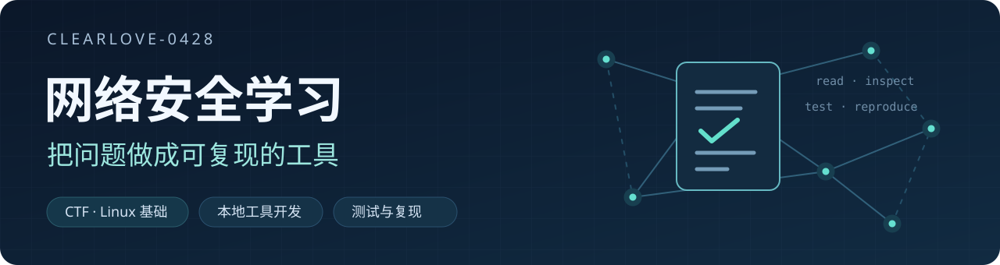

  

  <strong>西北工业大学在读 · 软件开发与学习实践</strong>

  <a href="#关于我">关于我</a> ·
  <a href="#项目一览">项目一览</a> ·
  <a href="#技术与学习">技术与学习</a>

## 关于我

你好，我是 Clearlove-0428，目前在西北工业大学学习。

我喜欢从学习和日常使用中的具体问题出发，尝试用代码做一些实用的工具。这里记录我的个人项目和学习实践，涉及本地应用、数据处理、自动化和网络安全。

开发过程中会使用 AI 辅助，也会整理使用说明、测试记录和遇到的问题，让项目能被理解、使用和继续改进。

## 项目一览

| 项目 | 简介与进展 |
| :--- | :--- |
| **[拾光 Shiguang](https://github.com/Clearlove-0428/shiguang)** | 本地通知整理与日程提醒工具，将通知中的时间安排整理为可核对、可确认的日程，并提供提醒。  **已公开** · [项目介绍](https://github.com/Clearlove-0428/shiguang#readme) · [实现与验证](https://github.com/Clearlove-0428/shiguang/blob/main/docs/validation.md) |
| **[雨课堂课件导出](https://github.com/Clearlove-0428/yuketang-slide-export)** | 将账号可见的课堂课件图片整理为 PDF，保留播放顺序和页码映射，支持像素去重与失败续跑。  **已公开** · [项目介绍](https://github.com/Clearlove-0428/yuketang-slide-export#readme) · [测试记录](https://github.com/Clearlove-0428/yuketang-slide-export/actions) |
| **[启翔湖畔资料工具](https://github.com/Clearlove-0428/qixiang-channel-toolkit)** | 在本机整理页面观察资料，支持跨批去重、人工复核、统计导出和离线浏览，保留来源与复核依据。  **已公开** · [项目介绍](https://github.com/Clearlove-0428/qixiang-channel-toolkit#readme) · [验证记录](https://github.com/Clearlove-0428/qixiang-channel-toolkit/blob/main/docs/%E9%AA%8C%E8%AF%81%E7%8A%B6%E6%80%81.md) |
| **CTF 离线工具箱** | 面向 CTF 学习与练习的本地工具集合，涵盖编码、密码学基础、文件与图片分析、流量分析等，并配有中文手册和示例。  **本地项目** · 正在整理公开版本 |
| **Linux 排查实验工具** | 围绕系统状态采集、快照差异、编号证据和时间线开展实验，并尝试用 Agent Skill 组织只读排查流程。  **本地项目** · 尚未公开 |

## 技术与学习

项目中接触和使用的技术：

`Python` `JavaScript` `Node.js` `SQLite` `PowerShell` `C# / WebView2`

我在实践中继续学习编程、数据处理、Linux 和网络安全基础，也关注界面体验、自动测试与代码可维护性。

---

个人项目与学习记录，持续更新。

